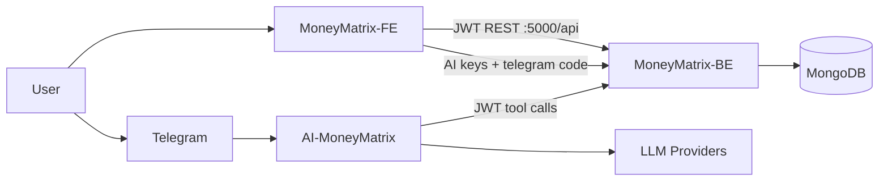

# MoneyMatrix Full System Analysis

**Date:** 2026-11-22  
**Scope:** `MoneyMatrix-FE` · `MoneyMatrix-BE` · `AI-MoneyMatrix`  
**Purpose:** Reverse-engineer how the stack works, score quality, and list prioritized changes for performance, security, and production readiness.

---

## Verdict

**Solid MVP / learning-to-product architecture — not production-hardened yet.**

Domain coverage is coherent: banks, cash wallet, income/expense/transfers, friend IOUs, EMI, subscriptions, reports, PDF, and a Telegram-facing AI agent. Layering is clear (FE = UI, BE = system of record, AI = agent façade).

Main gaps: **no automated tests**, AI Redis/Qdrant pieces are **in-memory stubs**, **FE↔BE↔AI contract drift** (transaction delete), **plaintext AI API keys**, and several **money/dashboard correctness bugs**. Treat this as a strong foundation for a personal-finance product, not a deploy-and-forget production system.

---

## 1. System Map

| Repo | Role | Stack (summary) |
|------|------|-----------------|
| **MoneyMatrix-FE** | User UI (CSR SPA) | Vite 8, React 19, Redux Toolkit, Tailwind, Axios → BE |
| **MoneyMatrix-BE** | System of record + auth | Express 4, MongoDB/Mongoose 8, JWT, node-cron, Nodemailer, Puppeteer PDF |
| **AI-MoneyMatrix** | Conversational agent + Telegram | FastAPI, LangGraph, multi-provider LLM, httpx → BE |

**Branding drift:** UI/product copy often says **FinTrack**; folders say **MoneyMatrix**; npm packages say **expense-tracker**. Unify naming before external launch.



**Default local ports**

| Service | Port |
|---------|------|
| FE (Vite) | `5173` |
| BE (Express) | `5000` (`/api`) |
| AI (Uvicorn) | `8000` |

---

## 2. How Each Repo Works

### 2.1 MoneyMatrix-FE

**Path:** `MoneyMatrix-FE/`

- **Bootstrap:** `index.html` → `src/main.jsx` (Redux + PersistGate + BrowserRouter) → `src/App.jsx`
- **Routing:** Guest routes (`/login`, `/register`); protected shell `AppLayout` with lazy pages (`/dashboard`, `/transactions`, `/banks`, `/cash-wallet`, `/emis`, `/subscriptions`, `/categories`, `/reports`, `/analytics`, `/settings`)
- **State:** Redux Toolkit slices; only `auth` is persisted (`fintrack` key). JWT also in `localStorage.token`
- **API:** `src/services/api.js` (Axios, Bearer JWT, 401 → logout + hard redirect); domain facades in `src/services/endpoints.js`
- **UI:** Tailwind + Radix-style primitives, Recharts, Framer Motion, page skeletons, PWA (`public/sw.js`, `manifest.json`)
- **AI surface:** Settings stores BYO LLM (`aiProvider`, encrypted `aiApiKey`, `aiModel`, `aiBaseUrl`) via BE profile; in-app `/assistant` + Telegram use those settings. Providers: groq, gemini, openai, anthropic, grok, huggingface, custom (OpenAI-compatible)

**Notable gaps**

- `transactionSlice` delete path expects a service method that is missing in `endpoints.js`
- `fetchMe` hydrates user via dashboard payload, not `GET /auth/profile`
- Unused deps: `react-hook-form`, `zod`, `@hookform/resolvers`; unused `pdfService` (pages use client `html2pdf.js` instead)
- README is stock Vite; no `.env.example`

### 2.2 MoneyMatrix-BE

**Path:** `MoneyMatrix-BE/`

- **Bootstrap:** `src/server.js` → connect Mongo → start cron → `app.listen`
- **App:** `src/app.js` — CORS, JSON, morgan, mount `/api`, error handler
- **Layering:** routes → validators → controllers → services → Mongoose models
- **Domain models:** User (settings include AI keys), Bank, CashWallet, Category, Transaction, EmiPayment, Subscription, TelegramCode (TTL)
- **API surface (under `/api`):** auth, banks, cash, categories, transactions, emis, subscriptions, dashboard, reports, pdf, telegram facades
- **Jobs:** in-process `node-cron` for EMI/subscription auto-deduction and email summaries / friend reminders
- **Auth:** JWT Bearer (`{ id, email }`), bcrypt passwords, ~7d expiry; no refresh/revocation list

**Transactions**

- Create income / expense / transfer (+ friend notify email)
- List with filters/pagination
- `PATCH /:id/settle-friend`
- **No update/delete routes** (AI tools and FE UI assume delete exists)

**Ops gaps:** no BE Dockerfile, no migration framework, no Redis/queue, no real lint/tests, Postman collection partial.

### 2.3 AI-MoneyMatrix

**Path:** `AI-MoneyMatrix/`

- **Bootstrap:** `uvicorn app.main:app` (Dockerfile healthcheck on `/health`); lifespan starts APScheduler
- **Agent graph** (`app/graph/`): `START → intent → slots → confirmation → tool_execution → response_formatting → END`
- **Tools** (`app/tools/`): create/list/delete transaction, get bank balance, query financial insights (RAG-style)
- **Backend client:** JWT-authenticated httpx to BE (`BACKEND_BASE_URL`)
- **Channels:** HTTP `POST /api/v1/chat` (Bearer required); Telegram webhook `POST /api/v1/telegram/webhook` (no auth today)
- **Memory / RAG:** `session_store.py` and `qdrant_client.py` are **process-local dicts** — Redis and Qdrant are declared/configured but not truly integrated
- **Workers:** budget alerts / EMI reminders — currently miswired (see bugs)

**Docs/ops gaps:** no README, no `.env.example`, no tests; `telegram.md` has historically contained live-looking bot token material; large unrelated markdown dumps in repo.

---

## 3. End-to-End Flows

### 3.1 Auth and dashboard

```
Register/Login (FE)
  → POST /api/auth/register|login (BE)
  → JWT stored (localStorage + Redux)
  → Protected AppLayout
  → fetchDashboard + fetchBanks
  → pages mutate via domain APIs
```

### 3.2 Add money movement

```
AddTransactionModal / page form
  → POST /api/transactions
  → BE validates + adjusts bank/cash balances
  → optional friend email
  → FE slice updates / refetch on lastUpdated
```

Transfers support bank↔bank and bank↔cash. Absolute balance PUTs on bank/cash can desync the ledger if used carelessly.

### 3.3 EMI / subscription auto-deduction

```
node-cron (BE)
  → find due EMI/Subscription
  → create expense transaction
  → debit balance
  → advance nextDueDate
```

Requires care in multi-instance deploys (in-process cron can double-run).

### 3.4 Telegram AI link

```
FE Settings → POST /api/auth/generate-telegram-code (BE)
User → Telegram /start <code>
AI webhook → POST /api/auth/verify-telegram-code (BE) → user_id + JWT
AI stores link in process memory TELEGRAM_USER_LINKS
Further messages → same LangGraph tools → BE with that JWT
```

### 3.5 Chat API (exists, unused by FE)

```
Client → POST /api/v1/chat (Authorization: Bearer)
  → optional LLM creds from body/headers or BE profile
  → LangGraph ainvoke
  → tools hit BE
  → session_store save
```

Manifest/marketing imply an in-app AI assistant; runtime UX is **Telegram + settings**, not embedded chat.

---

## 4. Quality Scorecard

| Dimension | Score | Notes |
|-----------|-------|-------|
| Domain / product fit | **Strong** | Personal finance coverage is complete for an MVP |
| Architecture clarity | **Good** | Clear FE / BE / AI split; BE remains data authority |
| Correctness (money paths) | **Mixed** | Several ledger/dashboard bugs; delete contract broken |
| Security | **Weak for prod** | Plaintext AI keys, open Telegram webhook, weak code space, no rate limits/helmet |
| Performance | **OK at small scale** | No cache/queue; AI double-LLM + stub RAG; FE over-fetch; Puppeteer heavy |
| Reliability / scale | **Weak** | In-memory AI state; in-process cron; no multi-replica story |
| DX / docs | **Weak** | Branding inconsistency; missing READMEs / env examples; dead deps |
| Tests | **None** | No unit/integration/e2e across all three repos |
| Production readiness | **Not yet** | Fix P0 bugs + security before any real user money data |

**Overall:** Good project for an MVP demo and iteration. Needs a focused hardening pass before production or multi-user trust.

---

## 5. Critical Bugs and Contract Gaps

| ID | Area | Issue | Impact | Status |
|----|------|-------|--------|--------|
| B1 | BE dashboard | `getDashboardSummary` matches `userId` as string without ObjectId cast (other aggregates cast correctly) | Empty/wrong income-expense KPIs | **Fixed** (Session 1) |
| B2 | BE transfers | `cash_to_bank` can persist `bankId: "cash"` (invalid ObjectId ref) | Broken populate/filters; data integrity risk | **Fixed** (new writes; legacy `"cash"` refs may remain) |
| B3 | FE↔BE↔AI | AI `DELETE /transactions/:id`; BE has no delete; FE delete thunk lacks service method | Delete UX/tools fail or crash | **Fixed** (BE DELETE + reverse balances; FE/AI wired) |
| B4 | AI workers | Proactive alerts call `process_telegram_message` (re-runs agent) instead of send-only | Wrong behavior + wasted LLM cost | **Fixed** |
| B5 | AI security | Telegram webhook unauthenticated; secrets historically in markdown docs | Spoofed updates; credential leak risk | **Fixed** (webhook secret + scrubbed docs) |
| B6 | AI sessions | Chat trusts client `user_id` for session key instead of JWT `sub` | Session confusion / cross-user memory risk | **Fixed** |
| B7 | BE ledger | Absolute cash/bank balance PUTs + bank delete without cascade/block | Balances can diverge from transaction history | **Fixed** (Session 2: balance PUTs write adjustment txns; bank delete blocked) |
| B8 | BE analytics | Graph analytics may ignore passed date range in `$match` | Misleading charts | **Fixed** |
| B9 | Versions/claims | AI health version vs app version mismatch; Redis/Qdrant “production” claims vs stubs | Ops confusion; false confidence | **Fixed** (version aligned; stubs documented honestly) |

---

## 6. Recommended Changes (Prioritized)

### P0 — Fix and secure (do first)

**Backend**

1. [x] Cast `userId` with `ObjectId` in `getDashboardSummary`.
2. [x] Stop writing `bankId: "cash"`; use null/`paymentMethod: "cash"`.
3. [x] Add transaction **delete** with reverse-balance logic; wire FE/AI.
4. [x] Soft-block bank delete when referenced; absolute cash/bank PUTs write ledger adjustments (Session 2).
5. [x] Rate-limit auth + `verify-telegram-code`; opaque codes; code emailed only (not in JSON).
6. [x] Helmet + JSON limits + redacted Mongo URI; `aiApiKey` AES-256-GCM at rest (Session 2); FE masks keys in UI.
7. [x] Fix graph analytics date-range `$match`.

**AI**

1. [x] Verify Telegram webhook `secret_token` via `TELEGRAM_WEBHOOK_SECRET`.
2. [x] Scrub tokens from docs; add `.env.example`; add `.gitignore` for `.env`.
3. [x] Bind session key to JWT claims; reject mismatched `user_id`.
4. [x] Fix proactive jobs to `send_message_direct` only.
5. [x] Align delete tool with BE; remove dead `delete_bank` from confirmation.
6. [x] Sanitize errors returned to clients; basic in-memory rate limiting.

**Frontend**

1. [x] Wire `transactionService.delete` to BE.
2. [x] Use `GET /auth/profile` for `fetchMe`.
3. [x] Mask AI API keys in Settings UI; Telegram “check email” flow.

### P1 — Performance

**AI**

1. [x] Reuse a shared `httpx.AsyncClient` on `BackendClient` (Session 2).
2. [x] Short-TTL cache for banks/categories/profile per token (Session 3).
3. [x] Skip second LLM formatting when tool output is already human-readable (Session 3).
4. [x] Redis sessions when `REDIS_URL` set; pruned in-memory fallback (Session 3).
5. [x] In-memory RAG capped/deduped; real Qdrant still future work (Session 3).

**Backend**

1. [x] Reuse Nodemailer transporter + in-process email queue (Session 3).
2. [x] pdfkit PDF path (no Chromium) (Session 3).
3. [x] Friend-reminder indexes on Transaction (Session 3).
4. Externalize cron / multi-instance leader still open (run single BE replica for now).

**Frontend**

1. [x] Deduplicate dashboard/banks fetches via 30s stale + force refresh (Session 2).
2. Lazy-load `html2pdf` / heavy chart pages; self-host fonts (drop blocking CSS `@import`).
3. Prefer server `pdfService.downloadMonthly` or drop unused client/server path.
4. Bundle analysis; trim unused deps (`zod`/`rhf` unless adopted).

### P2 — Product and DX

1. [x] Unify branding to **MoneyMatrix** (FE UI/manifest/package, BE package name, AI title) (Session 3).
2. [x] Root README + BE/AI `.env.example`; analysis MD as architecture note.
3. [x] Docker Compose for FE + BE + AI + Mongo + Redis.
4. [x] Core tests: BE `secretCrypto` (`npm test`); AI confirmation + format skip (`pytest`).
5. **Types:** incremental TypeScript (FE services/slices first) or strong JSDoc on BE.
6. [x] In-app AI chat at `/assistant` → AI `/api/v1/chat` (Session 3).
7. Adopt RHF + Zod on forms (deps already present on FE).
8. [x] Accessibility basics: removed `user-scalable=no`; aria-labels on key navbar/assistant controls.
9. Auth evolution: refresh tokens or shorter JWT + logout denylist if needed.
10. [x] BYO multi-LLM: Claude, HuggingFace, custom OpenAI-compatible base URL (Session 4; OpenAPI skipped).

---

## 7. Suggested 4-Week Roadmap

| Week | Focus | Outcomes |
|------|-------|----------|
| **1** | Correctness + security P0 | Dashboard ObjectId fix; transfer `bankId` fix; webhook secret; scrub secrets; align or disable delete; alert send-only fix |
| **2** | Ledger + encrypt + perf basics | **Done:** balance PUT adjustments; `aiApiKey` at-rest encrypt; shared httpx; FE fetch dedupe; SMTP reuse; root README + Compose |
| **3** | Performance + product | **Done:** BE cache; LLM format skip; Redis sessions; pdfkit; email queue; friend indexes; branding; `/assistant`; core tests; a11y basics |
| **4** | Polish pack | **Done:** BYO LLM; RHF/Zod; cron Mongo lock; Qdrant+embeddings; access/refresh JWT; webhook monitoring + `/health/ready`. Leftover: TypeScript migration |

After week 4 leftovers, reassess with monitoring/logging and a staged multi-instance deploy.

---

## 8. Repo Quick Reference

### MoneyMatrix-FE (key paths)

| Path | Purpose |
|------|---------|
| `src/App.jsx` | Routes, lazy pages, auth/theme bootstrap |
| `src/layouts/AppLayout.jsx` | Shell, sidebar, FAB, initial fetches |
| `src/services/api.js` | Axios + JWT interceptor |
| `src/services/endpoints.js` | Domain API facades |
| `src/redux/` | Store + slices |
| `src/pages/Settings.jsx` | Profile, LLM keys, Telegram link |

### MoneyMatrix-BE (key paths)

| Path | Purpose |
|------|---------|
| `src/server.js` / `src/app.js` | Bootstrap and Express app |
| `src/routes/` | HTTP surface under `/api` |
| `src/controllers/` + `src/services/` | Business orchestration |
| `src/models/` | Mongoose schemas |
| `src/cron/` | Auto-deduction jobs |
| `src/emails/` | Summaries and reminders |
| `src/middlewares/auth.js` | JWT gate |

### AI-MoneyMatrix (key paths)

| Path | Purpose |
|------|---------|
| `app/main.py` | FastAPI routes, lifespan |
| `app/llm/model_client.py` | BYO LLM factory (gemini/openai/groq/grok/anthropic/hf/custom) |
| `app/graph/` | LangGraph pipeline |
| `app/tools/` | BE-backed tools |
| `app/backend_client/client.py` | JWT httpx client |
| `app/memory/session_store.py` | In-memory sessions (Redis stub) |
| `app/rag/` | Qdrant + embeddings (memory fallback) |
| `app/channels/telegram/` | Bot link + messaging |
| `app/workers/` | Proactive scheduler tasks |

---

## 9. Bottom Line

You have a **coherent three-repo personal finance system** with a real product surface and a thoughtful AI/Telegram extension. The architecture choices (BE as source of truth, JWT passthrough to tools, LangGraph with confirmation guards) are sound for an MVP.

What keeps it from “best performance / production ready” is not missing features — it is **contract drift, money-path bugs, stubbed infra marketed as production, zero tests, and security shortcuts**. Execute **P0 → P1 → P2** in that order; do not invest in new features until delete/ledger/dashboard and webhook/secrets issues are closed.

---

*Generated from reverse-engineering of local repos under `D:\New folder\MoneyMatrix`. No application code was modified for this document.*
